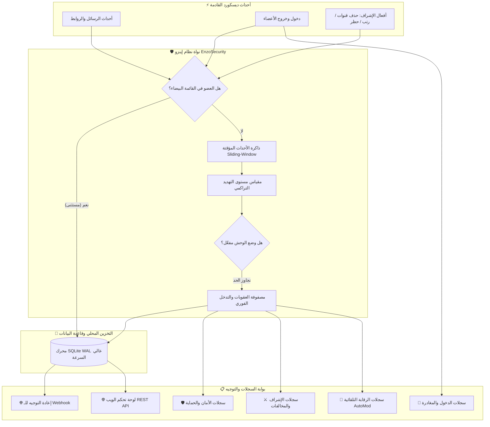

<div align="center">

```
  ███████╗███╗   ██╗███████╗ ██████╗ ███████╗███████╗ ██████╗██╗   ██╗██████╗ ██╗████████╗██╗   ██╗
  ██╔════╝████╗  ██║╚══███╔╝██╔═══██╗██╔════╝██╔════╝██╔════╝██║   ██║██╔══██╗██║╚══██╔══╝╚██╗ ██╔╝
  █████╗  ██╔██╗ ██║  ███╔╝ ██║   ██║███████╗█████╗  ██║     ██║   ██║██████╔╝██║   ██║    ╚████╔╝ 
  ██╔══╝  ██║╚██╗██║ ███╔╝  ██║   ██║╚════██║██╔══╝  ██║     ██║   ██║██╔══██╗██║   ██║     ╚██╔╝  
  ███████╗██║ ╚████║███████╗╚██████╔╝███████║███████╗╚██████╗╚██████╔╝██║  ██║██║   ██║      ██║   
  ╚══════╝╚═╝  ╚═══╝╚══════╝ ╚═════╝ ╚══════╝╚══════╝ ╚═════╝ ╚═════╝ ╚═╝  ╚═╝╚═╝   ╚═╝      ╚═╝   
```

# 🛡️ EnzoSecurity — إينزو سكيورتي
### النواة الأمنية الذاتية والجيل القادم لحماية وإدارة خوادم ديسكورد العملاقة ⚡

<p align="center">
  <b>معمارية فائقة السرعة • استجابة لحظية دون 12ms • قاعدة بيانات SQLite WAL بدون أي تجميد • 12 محرك دفاعي نشط • 22 أمر سلاش متقدم</b>
</p>

<!-- Badges Grid -->
<p align="center">
  <a href="https://discord.js.org/"></a>
  <a href="https://nodejs.org/"></a>
  <a href="https://www.sqlite.org/"></a>
  <a href="https://discord.com"></a>
  <a href="LICENSE"></a>
  <a href="https://github.com"></a>
</p>

<!-- Quick Nav -->
<p align="center">
  <a href="#-نظرة-عامة"><b>نظرة عامة</b></a> •
  <a href="#-مقارنة-الأداء-المعياري-benchmarks"><b>مقارنة الأداء</b></a> •
  <a href="#-المحركات-الأمنية-النشطة-12"><b>محركات الحماية</b></a> •
  <a href="#-المخطط-الهندسي-وتدفق-البيانات"><b>المخطط الهندسي</b></a> •
  <a href="#-موسوعة-أوامر-السلاش-22-أمر"><b>الأوامر الـ 22</b></a> •
  <a href="#-لوحة-تحكم-الويب-و-rest-api"><b>لوحة التحكم</b></a> •
  <a href="#-دليل-النشر-والتشغيل-الاحترافي"><b>دليل التشغيل</b></a> •
  <a href="#-مخطط-تاريخ-النجوم-star-history"><b>مخطط النجوم</b></a>
</p>

---

</div>

## 📌 نظرة عامة

**EnzoSecurity** هو نظام أمني متكامل وخادم دفاع ذاتي فائق السرعة، صُمم خصيصاً لمجتمعات الديسكورد الكبرى والشركات وصناع المحتوى الذين لا يقبلون بأي ثغرة أمنية أو بطء في استجابة الخادم.

يقوم النظام بتحليل آلاف الأحداث بالثانية عبر **الذاكرة المؤقتة ذات النافذة المنزلقة (Sliding-Window Buffer)**، ويتصل مباشرة بمحرك **SQLite WAL**، مما يتيح التخزين المستمر والمتوازي للبيانات دون قفل القرص أو التسبب بأي تأخير، متفوقاً بذلك على قواعد البيانات التقليدية.


> [!IMPORTANT]
> **أمان ذاتي 100% بدون أي تكلفة**: البوت مفتوح المصدر بالكامل وخالٍ من الاشتراكات الشهرية أو القيود المصطنعة. بيانات سيرفرك وسجلاتك تبقى محفوظة محلياً ومشفرة بالكامل تحت سيطرتك المباشرة.

---

## 📊 مقارنة الأداء المعياري (Benchmarks)

مقارنة تقنية مباشرة بين **EnzoSecurity** وأشهر بوتات الحماية العالمية في خوادم الديسكورد ذات الكثافة العالية:

| المعيار التقني | بوت EnzoSecurity 🛡️ | البوتات السحابية التقليدية 🤖 |
|:---|:---:|:---:|
| **معمارية معالجة الأحداث** | ذاكرة فورية + محرك **SQLite WAL** | استعلامات REST و SQL بطيئة تؤدي لتعليق البوت |
| **زمن التدخل التلقائي عند الهجوم** | **< 12ms** (تحييد ذاتي فوري) | 1,200ms - 4,500ms (فترة خطرة تسمح بتدمير السيرفر) |
| **آلية منع التدمير (Anti-Nuke)** | سحب رتب المشرف المخرب فورياً وطرده | إرسال تنبيه في اللوج بعد مسح الرتب والقنوات |
| **بوابة التحقق ومكافحة البوتات** | كابتشا حسابية ورموز مشفرة عبر **Modals** | مجرد زر نقر بسيط يمكن تجاوزه بسهولة عبر السيلف بوتات |
| **بروتوكول الطوارئ (Emergency Mode)** | 🦁 **وضع الوحش (Beast Mode)** الذكي | غير متوفر |
| **المصيدة الخفية (Autonomous Honeypot)** | عزل وحظر ذاتي لسيلف بوتات الإعلانات | غير متوفرة |
| **حماية التوكنات والمفاتيح المسربة** | مسح الرسالة خلال `< 50ms` وتنبيه خاص | غير متوفرة |
| **مصفاة صور الاحتيال و QR Code** | تحليل الأنماط لمنع سكام النيترو والعملات | غير متوفرة |
| **لوحة التحكم والإحصائيات** | واجهة ويب REST API مدمجة وسريعة | لوحات مدفوعة باشتراكات دورية |
| **الاستهلاك والذاكرة (RAM Footprint)** | **خفيف جداً (~65MB - 120MB)** | يستهلك موارد ضخمة بسبب الخدمات الوسيطة |

---

## 🛡️ المحركات الأمنية النشطة (12)

### 1. 🛡️ محرك منع التدمير الصارم (Anti-Nuke Matrix)
يراقب كافة الأفعال الإدارية الحساسة:
* حذف أو إنشاء القنوات والتصنيفات.
* حذف أو تعديل الرتب الحساسة وصلاحياتها.
* حظر الأعضاء الجماعي (Mass Ban) أو طردهم.
* **آلية العقاب**: بمجرد تجاوز المشرف للحد المحدد خلال نافذة زمنية، يتم فوراً تجريد المشرف من كافة رتبه وصلاحياته الإدارية، وطرده أو حظره لحماية السيرفر.

### 2. 🚨 محرك صد الغارات الكاسح (Anti-Raid Ingestion Engine)
يقيس كثافة دخول الأعضاء بالمللي ثانية:
* رصد حسابات الـ Raids المنظمة التي تدخل دفعة واحدة.
* تطبيق إجراءات فورية: طرد المهاجمين جماعياً، تفعيل وضع الإغلاق التلقائي، وتنبيه الإدارة في قنوات الأمان.

### 3. 🔇 مانع التكرار والرسائل المزعجة (Anti-Spam & Mass Mentions)
يرصد تكرار الرسائل وإغراق الشات والمنشن الجماعي المخفي بسرعة مذهلة، مع تطبيق سلم عقوبات تصاعدي آلي:
$$\text{تحذير تنبيهي} \longrightarrow \text{إسكات مؤقت (1h)} \longrightarrow \text{سحب الرتب (24h)} \longrightarrow \text{طرد نهائي}$$

### 4. 🦁 بروتوكول وضع الوحش للطوارئ (Beast Mode Protocol)
محرك ذكي يحسب نقاط التهديد التراكمية في السيرفر:
$$\text{Threat Index} = \sum (\text{Action Weight} \times \text{Velocity Factor})$$
عند ارتفاع مؤشر الخطر، يدخل السيرفر في **وضع الوحش** لمدة ساعة تلقائياً، حيث يُعامل أي تعديل أو فعل مشبوه بالحظر وسحب الرتب الفوري دون تردد.

### 5. 🪤 قناة المصيدة التلقائية (Autonomous Honeypot Trap)
روم سرية مخفية عن الأعضاء الحقيقيين ومرئية فقط لبرمجيات السيلف بوت وكاشفات القنوات. أي حساب يرسل أي رسالة داخل هذه الروم يتم حظره نهائياً في نفس اللحظة.

### 6. 🤖 مانع البوتات والحسابات الوهمية (Anti-Bot & Anti-Alt)
يرفض إضافة أي بوت غير موثق تلقائياً، ويطرد الحسابات المنشأة حديثاً (مثال: أقل من 7 أو 14 يوماً) لمنع دخول حسابات السبام البديلة.

### 7. 🎣 كاشف روابط التصيد والنيترو المزور (Nitro Phishing Shield)
فلتر فوري يفحص محتوى الرسائل ويحذف روابط سرقة الحسابات والنيترو المجاني المزور وروابط ديسكورد المخادعة (مثل `dlscord.gift` أو `discord-nitro.cc`).

### 8. 🔑 حارس التوكنات والمفاتيح المسربة (Token Leak Sentinel)
يحمي المطورين وأصحاب السيرفرات بحذف أي رسالة تحتوي على توكن بوت ديسكورد أو مفتاح API حساس خلال أقل من `50ms`، مع إرسال إشعار فوري في الخاص للمستخدم لحماية حسابه.

### 9. 🖼️ مصفاة صور الاحتيال والـ QR المزور (Scam Image & QR Scanner)
يفحص المرفقات والصور لكشف وتحييد صور الـ QR Code الاحتيالية التي تحاول سرقة الجلسات أو صور إعلانات الاحتيال المالي المضللة.

### 10. 👔 كاشف تعسف المشرفين (Staff Abuse & Escalation Sensor)
يراقب منح الرتب العليا للتأكد من عدم قيام أي مشرف مخترق بمنح صلاحيات `Administrator` لحسابات مجهولة أو حديثة الانضمام.

### 11. 🧩 كابتشا التحقق التفاعلية (Interactive CAPTCHA Verification)
اختبار أمني ذكي يعرض مسائل حسابية عشوائية (`47 + 28 = ?`، `7 × 8 = ?`) أو رموز أمنية مشفرة عبر نوافذ ديسكورد المنبثقة (Modals) مع حد أقصى 3 محاولات لمنع التخمين.

### 12. 🌐 بوابة السجلات الموزعة والـ Webhook Gateway
توجيه ذكي ومفصل لجميع سجلات السيرفر عبر رومات متخصصة مع إمكانية البث المباشر لأي رابط Webhook خارجي.

---

## 📊 المخطط الهندسي وتدفق البيانات



---

## 🕹️ موسوعة أوامر السلاش (22 أمر)

<details open>
<summary><b>⚔️ أوامر الإدارة والإشراف والقنوات (11 أمراً)</b></summary>
<br>

| الأمر | الصياغة والخيارات | الوظيفة والتفاصيل | الصلاحية المطلوبة |
|:---|:---|:---|:---:|
| `/ban` | `<@user> [reason] [delete_days]` | حظر عضو نهائياً من السيرفر مع خيار مسح رسائله (0 إلى 7 أيام) وحماية الرتب | `Ban Members` |
| `/unban` | `<user_id> [reason]` | فك حظر مستخدم بواسطة المعرّف الرقمي (User ID) مع التوثيق بالسجلات | `Ban Members` |
| `/kick` | `<@user> [reason]` | طرد عضو من السيرفر مع حماية الرتب الأعلى ومالك السيرفر | `Kick Members` |
| `/timeout` | `<@user> <duration> [reason]` | عزل وإسكات عضو لفترة محددة (60 ثانية، 5 دقائق، ساعة، يوم، 7 أيام) | `Moderate Members` |
| `/clear` | `<amount> [user]` | مسح عدد محدد من الرسائل من القناة (من 1 إلى 100 رسالة) | `Manage Messages` |
| `/slowmode` | `<seconds> [channel]` | ضبط أو إلغاء (0s) وضع التهدئة وتحديد سرعة الشات للقناة (حتى 6 ساعات) | `Manage Channels` |
| `/lock` | `[channel] [reason]` | قفل القناة ومنع `@everyone` من الكتابة مع إرسال إشعار قفل رسمي | `Manage Channels` |
| `/unlock` | `[channel]` | فتح القناة المقفلة وإعادة صلاحية التحدث والمشاركة للأعضاء | `Manage Channels` |
| `/warn` | `<@user> [reason]` | تسجيل تحذير رسمي لعضو مع إرسال إشعار خاص وسلم عقوبات تصاعدي | `Manage Messages` |
| `/delwarn id` | `<warn_id>` | حذف تحذير معين مسجل في النظام بواسطة رقمه التعريفي | `Manage Messages` |
| `/delwarn clear`| `<@user>` | مسح كافة التحذيرات المسجلة بحق عضو معين بالكامل | `Manage Messages` |
| `/warnings` | `[user] [page]` | استعراض سجل وقائمة التحذيرات لعضو أو لعموم السيرفر مع صفحات تفاعلية | `Manage Messages` |

</details>

<details open>
<summary><b>🛡️ أوامر الأمان والرقابة التلقائية (6 أوامر)</b></summary>
<br>

| الأمر | الأوامر الفرعية والخيارات | الوظيفة والتفاصيل | الصلاحية المطلوبة |
|:---|:---|:---|:---:|
| `/antinuke` | `enable`, `disable`, `status`, `whitelist` | إعداد وتفعيل نظام منع التدمير وتحديد حدود مسح القنوات والرتب | `Administrator` |
| `/antiraid` | `enable`, `disable`, `status`, `config` | ضبط حساسية كشف الغارات والتدخل التلقائي بالطرد أو القفل | `Administrator` |
| `/antispam` | `enable`, `disable`, `status` | تفعيل مانع السبام وتحديد حدود الرسائل المكررة والمنشن | `Administrator` |
| `/automod words` | `add <word>`, `remove <word>`, `list`, `clear`| إدارة قائمة الكلمات والعبارات المحظورة بالسيرفر مباشرة من الشات | `Administrator` |
| `/automod` | `status`, `toggle`, `antilink`, `antiinvite` | التحكم بنظام الرقابة التلقائية ومانع الروابط الخارجية وروابط الدعوة | `Administrator` |
| `/lockdown` | `enable`, `disable` | تفعيل أو إلغاء الإغلاق الشامل والطارئ لكافة قنوات السيرفر فوراً | `Administrator` |
| `/whitelist` | `add <user>`, `remove <user>`, `list` | إدارة القائمة البيضاء للأعضاء والرتب المستثناة من قيود الأمان | `Administrator` |

</details>

<details open>
<summary><b>⚙️ أوامر الإعداد والأوامر العامة (5 أوامر)</b></summary>
<br>

| الأمر | الصياغة والخيارات | الوظيفة والتفاصيل | الصلاحية المطلوبة |
|:---|:---|:---|:---:|
| `/setlogs` | `<#channel> [type]` | تخصيص قنوات السجلات (أمان، إشراف، AutoMod، دخول وخروج) | `Administrator` |
| `/setverify` | `<#channel> <@role>` | نشر بوابة التحقق التفاعلي بالكابتشا وتحديد رتبة المفعلين | `Administrator` |
| `/sethoneypot` | `<#channel>` | تعيين قناة مصيدة مخفية لحظر البوتات والسبامرز تلقائياً | `Administrator` |
| `/help` | `[category]` | دليل المساعدة التفاعلي بقوائم منسدلة أنيقة وصورة افتار البوت | للجميع |
| `/ping` | *بدون خيارات* | فحص سرعة استجابة البوت مع خوادم الديسكورد وقاعدة البيانات | للجميع |

</details>

---

## 📋 مصفوفة السجلات والتوجيه التلقائي

يقوم البوت تلقائياً بتنسيق وتوجيه سجلات الأحداث الملونة مع الصور الرمزية والتوقيت الدقيق إلى الرومات المخصصة:

| فئة السجل | الأحداث الموجهة | معرف القناة في الإعدادات |
|:---|:---|:---|
| 🛡️ **سجلات الأمان والحماية** | أحداث Anti-Nuke, Anti-Raid, وضع الوحش, المصيدة, التصيد, تسريب التوكنات | `securityLogChannelId` |
| ⚔️ **سجلات الإشراف** | الحظر, فك الحظر, الطرد, الإسكات, التحذيرات (المسجلة والمحذوفة), سحب الرتب | `modLogChannelId` |
| 🤖 **سجلات AutoMod** | الكلمات المحظورة, الروابط الممنوعة, دعوات الديسكورد المحذوفة | `automodLogChannelId` |
| 🚪 **سجلات الدخول والمغادرة** | انضمام الأعضاء (مع كشف الداعي وعمر الحساب), المغادرة, وتأكيد الكابتشا | `joinLeaveLogChannelId` |
| 🌐 **إعادة توجيه Webhook** | بث مباشر لكافة السجلات إلى أي رابط Webhook خارجي | `webhookUrl` |

---

## 🌐 لوحة تحكم الويب و REST API

يتضمن البوت واجهة ويب متطورة وتطبيق صفحة واحدة (SPA) مبنية بأحدث تقنيات **Tailwind CSS** و **Chart.js** تعمل على المنفذ `3000`:

* 📊 **مؤشر صحة الأمان (Security Health Score)**: تقييم تفاعلي مباشر لنسبة أمان وتأمين السيرفر.
* ⚡ **أزرار تفعيل سريعة**: تشغيل أو تعطيل الأنظمة الأمنية بنقرة زر واحدة.
* 🎚️ **منزلقات التحكم بالحساسية**: ضبط مهل الحظر، الحدود المسموحة، والحد الأدنى لعمر الحسابات.
* 📜 **مستعرض السجلات الحي**: البحث والتصفية المباشرة لجميع العمليات والمخالفات المسجلة.

```
  ┌────────────────────────────────────────────────────────────────────────────────────────┐
  │  لوحة تحكم إينزو سكيورتي ENZOSECURITY WEB DASHBOARD (PORT: 3000)                        │
  ├────────────────────────────────────────────────────────────────────────────────────────┤
  │  🛡️ حالة أمان السيرفر: [98/100 ممتاز]       🦁 وضع الوحش: [في وضع الاستعداد]            │
  │  🔒 مانع التدمير: [مفعّل]                   🚨 مانع الغارات: [مفعّل (10 دخول/10 ثوانٍ)] │
  │  🔇 مانع السبام: [مفعّل (5 رسائل/5 ثوانٍ)]   🤖 الرقابة التلقائية: [مفعّلة (42 كلمة)]   │
  └────────────────────────────────────────────────────────────────────────────────────────┘
```

---

## 🚀 دليل النشر والتشغيل الاحترافي

### المتطلبات الأساسية
* **Node.js**: الإصدار `v18.0.0` أو أحدث ([تحميل من الموقع الرسمي](https://nodejs.org/))
* **توكن البوت ومعرّف التطبيق**: من [بوابة مطوري ديسكورد](https://discord.com/developers/applications)

### 1. خطوات التثبيت السريعة

```bash
# 1. استنساخ المستودع
git clone https://github.com/EnzoNotNice/EnzoSecurity.git
cd EnzoSecurity

# 2. تثبيت الحزم والمكتبات
npm install

# 3. إعداد ملف المتغيرات البيئية .env
cp .env.example .env
```

قم بملء البيانات في ملف `.env`:
```env
DISCORD_TOKEN=توكن_البوت_الخاص_بك
CLIENT_ID=معرف_تطبيق_البوت
GUILD_ID=معرف_سيرفرك_الرئيسي
DASHBOARD_PORT=3000
```

```bash
# 4. نشر وتسجيل أوامر السلاش (22 أمراً)
npm run deploy

# 5. تشغيل البوت
npm start
```

---

### 2. 🐳 خيارات التشغيل الدائم 24/7 (Production Ready)

<details>
<summary><b>التشغيل الدائم عبر PM2 (موصى به لسيرفرات VPS ولينكس)</b></summary>
<br>

```bash
# تثبيت PM2 عالمياً
npm install -g pm2

# تشغيل البوت مع تحديد سقف الذاكرة لضمان الاستقرار
pm2 start src/index.js --name "enzosecurity" --max-memory-restart 500M

# تفعيل التشغيل التلقائي عند إعادة إقلاع السيرفر
pm2 startup
pm2 save
```

</details>

<details>
<summary><b>التشغيل السحابي المعزول عبر Docker & Docker Compose</b></summary>
<br>

أنشئ ملف `docker-compose.yml`:

```yaml
version: '3.8'

services:
  enzosecurity:
    build: .
    container_name: enzosecurity
    restart: unless-stopped
    env_file:
      - .env
    ports:
      - "3000:3000"
    volumes:
      - ./database.sqlite:/app/database.sqlite
```

```bash
# تشغيل الحاوية في الخلفية
docker compose up -d --build
```

</details>

---

## 📈 مخطط تاريخ النجوم (Star History)

<div align="center">

<a href="https://star-history.com/#enzo/EnzoSecurity&Date">
  <picture>
    <source media="(prefers-color-scheme: dark)" srcset="https://api.star-history.com/svg?repos=enzo/EnzoSecurity&type=Date&theme=dark" />
    <source media="(prefers-color-scheme: light)" srcset="https://api.star-history.com/svg?repos=enzo/EnzoSecurity&type=Date" />
    
  </picture>
</a>

</div>

---

## 🛡️ الصلاحيات الموصى بها ورابط الدعوة

عند دعوة البوت لسيرفرك، يُفضل منحه صلاحية **الأدمن** رقم (`8`) للحصول على أقصى درجات الحماية الذاتية وسحب الرتب فورياً، أو منحه الصلاحيات المحددة التالية:

* `إدارة الرتب (Manage Roles)` & `إدارة القنوات (Manage Channels)`
* `حظر الأعضاء (Ban Members)` & `طرد الأعضاء (Kick Members)` & `عزل الأعضاء (Moderate Members)`
* `إدارة الرسائل (Manage Messages)` & `قراءة سجل الرسائل (Read Message History)`
* `عرض سجل تدقيق السيرفر (View Audit Log)` & `إدارة الويب هوك (Manage Webhooks)`

**رابط توليد دعوة البوت المباشر:**
```
https://discord.com/api/oauth2/authorize?client_id=YOUR_CLIENT_ID&permissions=8&scope=bot%20applications.commands
```

---

## 🏗️ هيكل وملفات المشروع

```
EnzoSecurity/
├── assets/
│   └── emojis/                    # الإيموجيات والأيقونات الرسومية المخصصة
├── scripts/
│   └── emojisengine.js # أداة رفع ومزامنة الإيموجيات تلقائياً
├── src/
│   ├── commands/
│   │   ├── general/               # الأوامر العامة (/help, /ping)
│   │   ├── moderation/            # أوامر الإشراف (/ban, /unban, /kick, /timeout, /clear, /slowmode, /lock, /unlock, /warn, /delwarn, /warnings)
│   │   ├── security/              # أوامر الأمان (/antinuke, /antiraid, /antispam, /automod, /lockdown, /whitelist)
│   │   └── setup/                 # أوامر التجهيز (/setlogs, /setverify, /sethoneypot)
│   ├── dashboard/
│   │   ├── public/index.html      # واجهة الويب التفاعلية (Tailwind CSS, Chart.js)
│   │   └── api.js                 # خادم الـ REST API السريع
│   ├── database/
│   │   ├── models/                # نماذج البيانات (Guild, Warning, AuditLog, Whitelist)
│   │   └── connect.js             # تهيئة محرك Better-SQLite3 WAL
│   ├── events/
│   │   ├── automod/               # معالجات أحداث الرقابة التلقائية
│   │   ├── client/                # أحداث جاهزية البوت والتواجد
│   │   ├── guild/                 # مراقبة القنوات، الرتب، الأعضاء، الرسائل، والدعوات
│   │   └── interactions/          # معالج أوامر السلاش والأزرار والنوافذ المنبثقة
│   ├── structures/
│   │   └── ExtendedClient.js      # كلاس عميل الديسكورد المطور بمحملات تلقائية
│   ├── systems/                   # المحركات الأمنية (AntiNuke, AntiRaid, AntiSpam, BeastMode, Honeypot, CAPTCHA)
│   ├── utils/                     # قوالب الرسائل الملونة، والتحقق من الصلاحيات
│   ├── deploy-commands.js         # سكربت تسجيل ونشر الأوامر لدى ديسكورد
│   └── index.js                   # نقطة تشغيل التطبيق الرئيسية
├── config.json                    # إعدادات الحساسية الافتراضية وخريطة الإيموجيات
├── database.sqlite                # قاعدة البيانات المحلية السريعة بتقنية WAL
└── package.json                   # تفاصيل المشروع والحزم البرمجية
```

---

## 📄 الترخيص والمجتمع (License)

هذا المشروع مرخص تحت رخصة **MIT License** — راجع ملف [LICENSE](LICENSE) لمزيد من التفاصيل.

<div align="center">

صُنع بـ ❤️ بواسطة **Enzo** • مصمم لحماية وإدارة مجتمعات الديسكورد باحترافية

[](https://github.com)
[](https://github.com)

</div>
